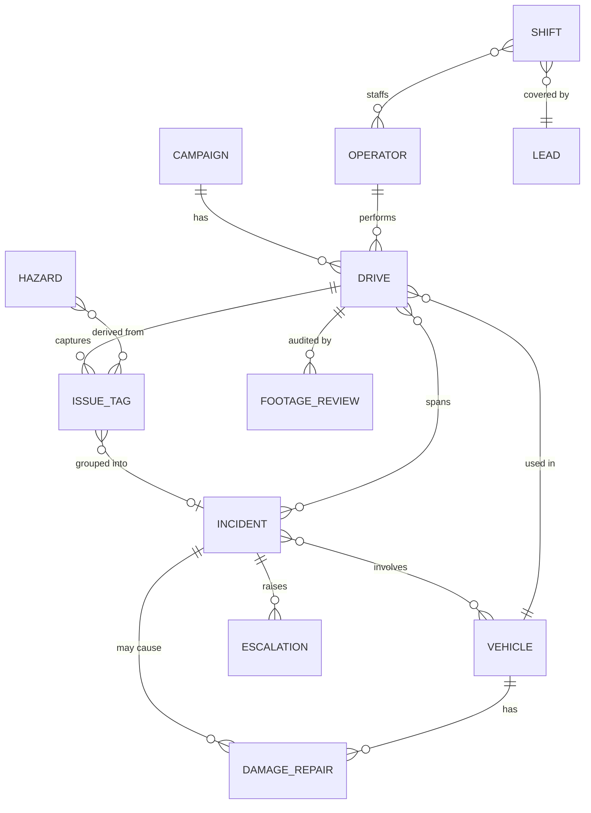

# Object model: Fleet Console

Source: brief.md. Fixture data only; no real IDs, places, or people. Lifecycle names below are shared (see section 4).

## 1. Objects

| Object | Purpose | Key attributes | Lifecycle | Created / changed by |
|---|---|---|---|---|
| **Vehicle** | Test asset under oversight | fixture id, build/software version, condition, data health, current assignment | Available, In drive, Down (repair), Retired | Operator (condition notes); technician (repair state) |
| **Operator** | Person who drives/tests | name (fixture), shift, certifications, current drive | On shift, Off shift | Lead (roster) |
| **Lead** | Remote safety manager, human redundancy | shift, span (operators covered), on-call state | On call, Off call | Lead; scheduler |
| **Shift** | Coverage window (24/7, three shifts) | window, covering lead, on-call backup, operator list | Planned, Active, Closed, Uncovered | Lead / scheduler |
| **Drive (run)** | One test session of a vehicle by an operator | vehicle, operator, route, start/end, ODD conditions, campaign | Planned, Active, Ended, Reviewed | Operator; auto-ended by telemetry |
| **Issue tag** | 1-tap in-moment capture (phantom brake, planner freeze, sensor drop) | type, timestamp, drive, location on route, proposed severity | Captured, Triaged (becomes or joins an Incident, or is dismissed) | Operator (in-vehicle, iOS) |
| **Incident** | A triaged problem needing ownership | severity, type, vehicles, drive(s), tags, owner, escalation path, notes | Captured, Triaged, Owned, Resolved, Verified | Operator opens; lead triages/owns |
| **Escalation** | Hand-off of an Incident up a chain | incident, from, to, backup, acknowledged-at, timeout | Raised, Acknowledged, Handled, Timed out (auto re-routes) | System on Sev1 or unacknowledged; lead |
| **Footage review** | Audit of onboard footage | drive, segment, reviewer, due date, findings | Queued, In review, Done, Overdue | System queues; lead/reviewer completes |
| **Damage / repair** | Vehicle condition and technician work | vehicle, part, severity, technician, linked incident | Reported, Owned, Resolved, Verified | Operator reports; technician updates |
| **Hazard** | Route location with a recurring risk | location (fixture), type, linked tags/incidents | Active, Mitigated, Stale | Derived from tags; lead curates |
| **Campaign** | Test program with coverage targets | ODD targets (day, night, rain, dense traffic), vehicles | Planning, Running, Complete | Lead / engineering |
| **ODD coverage** | Progress of drives against campaign targets | condition, target, achieved | Derived (no own lifecycle) | System, from Drives |
| **Data health** | Telemetry quality per vehicle/drive | write-rate, storage, sensor sync | Healthy, Degraded, Failing (derived) | System |
| **Oversight debt** | Derived load measure for leads | unreviewed footage, open incidents, uncovered shifts, stale escalations | Derived | System |

## 2. Relationships

Navigation-hard relationships:
- **Incident is reached from five parents**: vehicle, drive, hazard, shift, and the lead's queue. Needs one canonical page, many entry points.
- **Incident to Drive and Vehicle are many-to-many** (one incident can span drives; a multi-vehicle event). Do not nest incidents under a single parent.
- **Issue tag to Incident is optional many-to-one**: tags exist before triage. The lead's inbox must show un-triaged tags, not just incidents.
- **Escalation depends on Shift**: who is reachable is a function of time. Escalation must resolve through shift coverage, not a fixed person.
- **Oversight debt is derived across four objects** (footage, incidents, escalations, shifts); it has no home unless it is made one.

## 3. Jobs to be done

| User | Job | Frequency | Urgency |
|---|---|---|---|
| Operator | Tag an issue without leaving the task | per drive (many) | safety-critical |
| Operator | Raise an emergency / collision call and get guided steps | rare, per event | safety-critical |
| Operator | Report vehicle condition and damage | per drive | same-day |
| Operator | Triage own tags into incidents with data | daily | same-day |
| Operator | Check ODD coverage and plan next drive | daily | same-day |
| Lead | Receive and act on an escalation, with a backup if unanswered | per event | safety-critical |
| Lead | Know which shifts and operators are uncovered right now | continuously, each shift | safety-critical |
| Lead | Triage new incidents and assign owners | daily (several times) | same-day |
| Lead | Audit footage and clear the review queue | daily/weekly | same-day to reporting |
| Lead | Follow up every incident to Verified | daily | same-day |
| Lead | Show workload and oversight debt to leadership | weekly | reporting |
| Lead | Check campaign ODD coverage and data health | weekly | reporting |

**Highest-friction jobs (marked):**
1. **Escalation that does not depend on one person** (lead receives/hands off, safety-critical, single point of failure).
2. **Seeing coverage gaps and oversight debt before an incident** (invisible workload, silent backlog).
3. **In-moment issue capture within a 2-second glance** (if capture is slow, everything downstream is thin).

## 4. Taxonomies

**Severity (one scale for all surfaces; replaces v1's two scales).** Three levels, each tied to a distinct required response:

| Level | Meaning | Response |
|---|---|---|
| **SEV1** | Safety risk or collision; people or road affected | Immediate; auto-escalates; backup if unacknowledged |
| **SEV2** | Behavior fault or damage, vehicle usable with limits | Same shift; owner required |
| **SEV3** | Minor, cosmetic, or data-quality | Batch review; weekly |

Three because each level changes who acts and how fast; a fourth would not change behavior and would slow in-vehicle tagging. Applies to tags, incidents, damage, data health, and footage findings. Hazards and ODD are not severities.

**Status (one lifecycle for Incident, Damage/repair, Footage review).** Captured, Triaged, Owned, Resolved, Verified. Exceptions are flags, not states: Escalated, Overdue, Stale. Verified requires someone other than the resolver.

## 5. Open questions
1. Is the lead's span per shift or per program? This drives the coverage view.
2. Do operators triage their own tags, or only the lead?
3. Is damage/repair owned by technicians in this tool, or only reported?
4. Who is the second responder when the on-call lead is unreachable (peer lead, manager, or rota)?
5. Is footage audit by sampling or by every incident?
6. What is the iOS scope: lead escalation only, or operator capture too?
